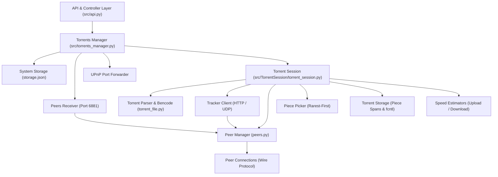

# דוח התקדמות פרויקט גמר – לקוח BitTorrent חינוכי
**דוח סטטוס פיתוח תקופתי והשוואה מול דרישות המפרט וההנחיות הרשמיות**

---

### פרטי הפרויקט והדוח
* **נושא הפרויקט:** פיתוח לקוח BitTorrent חינוכי ואסינכרוני מודולרי
* **סביבת פיתוח:** Python 3.12, Asyncio, Raw Sockets, Flask & REST API
* **תאריך עדכון:** נובמבר 2026
* **סטטוס כללי:** **ליבת המערכת ודרישות ה-MVP הושלמו במלואן (100%)**, לרבות שכבת ה-API ומגוון תכונות בונוס מתקדמות (Rarest-First, Choking Tit-for-Tat, Multi-file, Seeding, UPnP Port Forwarding, IPv6, UDP Trackers). היעד המרכזי הבא הוא פיתוח ממשק המשתמש הגרפי הסופי (Desktop GUI).

---

## 1. מטרת הפרויקט
מטרת הפרויקט הינה פיתוח תוכנת מחשב חינוכית שלמה המממשת את עקרונות פרוטוקול BitTorrent, ומדגימה באופן מעשי ומעמיק עבודה עם מערכות Peer-to-Peer מבוזרות. הפרויקט משלב נושאי ליבה מרכזיים במדעי המחשב ובהנדסת תוכנה:
1. **רשתות מחשבים ותקשורת עמית-לעמית:** מימוש תקני של פרוטוקול BitTorrent Wire על גבי Raw TCP Sockets, תקשורת מול שרתי Tracker בפרוטוקולי HTTP ו-UDP, פענוח חבילות רשת בינאריות ותקשורת מבוזרת.
2. **תכנות מקבילי ואסינכרוני מתקדם:** תכנון מבוסס Asyncio Event Loop, שימוש ב-`TaskGroup`, משימות רקע (Background Workers), נעילות אסינכרוניות (`asyncio.Lock`), ותורים לתקשורת שוטפת מול עשרות עמיתים במקביל ללא חסימת ה-Thread הראשי וללא צווארי בקבוק.
3. **ניהול קבצים ומערכות אחסון:** מיפוי בינארי מדויק של Pieces ו-Blocks לקבצים בודדים ומרובים בדיסק (Piece-to-File Spans), תוך שימוש בנעילת קבצים ברמת מערכת ההפעלה (`fcntl.flock`) לסנכרון קריאה וכתיבה מקבילית.
4. **אימות שלמות קריפטוגרפי:** אימות אמין של שלמות המידע באמצעות חישוב גיבובי SHA-1 לכל מקטע שהורד, עם מנגנון פסילה והורדה חוזרת מעמיתים אחרים בעת זיהוי שגיאות.
5. **ארכיטקטורת תוכנה מודולרית:** הפרדה מוחלטת והדוקה בין לוגיקת הפרוטוקול, מנהל החיבורים, שכבת האחסון ושכבת הבקרה וה-API.

---

## 2. עקרונות והגבלות שימוש
בהתאם להנחיות הרשמיות של פרויקט הגמר, המערכת תוכננה ופותחה תחת גבולות אקדמיים ברורים:
* **שימוש אך ורק בקבצי Torrent חוקיים:** כלל הבדיקות והניסויים בפרויקט מבוצעים מול קבצי הפצה חופשיים (כדוגמת Linux ISOs של Ubuntu ו-Debian) ומאגרי נתונים אקדמיים פתוחים.
* **איסור מוחלט על הפצת תוכן פיראטי:** המערכת אינה כוללת מנועי חיפוש פיראטיים או מנגנונים להפצת תוכן המוגן בזכויות יוצרים.
* **מערכת לימודית/אקדמית בלבד:** מטרת הפיתוח הינה מחקרית-חינוכית בלבד להעמקת הידע בפרוטוקולי P2P ובמערכות מבוזרות.
* **היעדר מנגנוני עקיפה:** הפרויקט אינו כולל מנגנוני אנונימיזציה, הסתרת תעבורה או עקיפת DRM.

---

## 3. תיאור פונקציונלי וסטטוס מימוש דרישות המינימום (MVP)

להלן פירוט מעמיק ונאמן לקוד המקור של כל אחת מדרישות ה-MVP המופיעות בסעיף 4 במסמך ההנחיות, תוך השוואה בין מה שהוגדר למה שמומש בפועל בקוד:

### 4.1 קריאת קובץ Torrent (Torrent Parser)
* **מימוש בקוד:** [src/utils/bencode.py](file:///home/ori/Programming/DegreeProject/Project/src/utils/bencode.py) ו-[src/TorrentSession/torrent_file.py](file:///home/ori/Programming/DegreeProject/Project/src/TorrentSession/torrent_file.py).
* **מה בוצע בפועל:**
  * **מנוע Bencode עצמאי:** מימוש מלא של פענוח (`decode_bencode`) וקידוד (`encode_bencode`) לכל ארבעת הטיפוסים התקניים: מספרים שלמים (Integers), מחרוזות בתים (Byte strings), רשימות (Lists) ומילונים (Dictionaries).
  * **חילוץ מדויק של Info-Hash:** המפענח מזהה את גבולות הבתים המדויקים של מילון ה-`info` (`info_start`, `info_end`) מתוך מערך הבתים הגולמי ומחשב עליהם ישירות גיבוב SHA-1, מה שמבטיח דיוק מוחלט ומניעת עיוותים שמקורם בשינוי סדר מפתחות.
  * **חילוץ רשימת גיבובי Pieces:** חלוקה תקנית של ה-`pieces blob` למערך של גיבובי SHA-1 באורך 20 בתים לכל מקטע.
  * **תמיכה ב-Single-file וב-Multi-file:** חילוץ מבנה הקבצים, שמות הקבצים, האורכים, שדות UTF-8 מתקדמים (`name.utf-8`, `path.utf-8` לפי תקן BEP 0047), רשימות Trackers מדורגות (`announce-list` לפי תקן BEP 0012) ו-Web Seeds (לפי תקן BEP 0019).
* **סטטוס:** **בוצע במלואו (100% - כולל הרחבות מתקדמות מעבר לדרישות המינימום).**

### 4.2 עבודה מול שרתי Tracker (Tracker Client)
* **מימוש בקוד:** [src/TorrentSession/contact_tracker.py](file:///home/ori/Programming/DegreeProject/Project/src/TorrentSession/contact_tracker.py) ו-[src/TorrentSession/tracker_client.py](file:///home/ori/Programming/DegreeProject/Project/src/TorrentSession/tracker_client.py).
* **מה בוצע בפועל:**
  * **תמיכה ב-HTTP וב-UDP Trackers:** תמיכה מלאה הן ב-HTTP Tracker (BEP 0003) והן ב-UDP Tracker בינארי (BEP 0015) הכולל שליחת בקשת Connect, קבלת `connection_id`, ושליחת `announce packet` תקני עם `transaction_id`.
  * **שליחת אירועים ועדכונים מחזוריים:** שליחת אירועי `started`, `completed`, `stopped`, וביצוע `keep-alive` מחזורי ברקע בהתאם למרווח הזמן (`interval`) שמתקבל מהשרת.
  * **פענוח רשימות עמיתים (Peers Parsing):** תמיכה בפענוח מילוני עמיתים קלאסיים וכן בפענוח קומפקטי בינארי מהיר של כתובות IPv4 (6 בתים לכל עמית) וכתובות IPv6 (18 בתים לכל עמית - `peers6`).
  * **ריבוי Trackers וטיפול בשגיאות:** תמיכה בהגדרת כמות ה-Trackers הפעילים במקביל (`tracker_amount`), מעבר אוטומטי בין שרתים במקרה של כשל, וטיפול ב-Timeouts ושגיאות תקשורת.
* **סטטוס:** **בוצע במלואו (100% - כולל תמיכה מלאה ב-UDP וב-IPv6).**

### 4.3 תקשורת Peer-to-Peer (P2P Communication)
* **מימוש בקוד:** [src/TorrentSession/peers/](file:///home/ori/Programming/DegreeProject/Project/src/TorrentSession/peers/), [src/peers_receiver.py](file:///home/ori/Programming/DegreeProject/Project/src/peers_receiver.py) ו-[src/utils/port_forward.py](file:///home/ori/Programming/DegreeProject/Project/src/utils/port_forward.py).
* **מה בוצע בפועל:**
  * **לחיצת יד תקנית (Handshake):** מימוש מדויק של פרוטוקול הלחיצה הבינארי בן 68 הבתים (`protocol_length`, `protocol_string`, `reserved_bytes`, `info_hash`, `peer_id`) כולל אימות קפדני של ה-info_hash.
  * **מימוש מלא של 9 הודעות הפרוטוקול התקניות:**
    * `Choke` (0) / `Unchoke` (1) – בקרת זרימת מידע.
    * `Interested` (2) / `Not Interested` (3) – הצהרת עניין במידע.
    * `Have` (4) – דיווח על מקטע שהושלם.
    * `Bitfield` (5) – שיתוף מפת המקטעים המלאה.
    * `Request` (6) – בקשת בלוק נתונים ספציפי (אינדקס מקטע, היסט ואורך).
    * `Piece` (7) – העברת בלוק נתונים בפועל.
    * `Cancel` (8) – ביטול בקשת בלוק שהמתינה בתור.
  * **הורדה מקבילית ממספר עמיתים:** הורדה מבוזרת של Pieces מעמיתים פנויים, פירוק כל Piece לבלוקים בני 16KB (`DEFAULT_BLOCK_LENGTH`), וחלוקת בקשות הבלוקים בין מספר עמיתים שאינם חוסמים (`_send_block_requests`).
  * **שרת האזנה לקבלת עמיתים נכנסים (Incoming Peers Server):** מודול `peers_receiver.py` מפעיל שרת TCP אסינכרוני המאזין לחיבורי עמיתים נכנסים על פורט 6881, מאמת את ה-Handshake ומנתב את החיבור לסשן הטורנט המתאים.
  * **פתיחת פורטים אוטומטית (UPnP Port Forwarding):** מודול `utils/port_forward.py` מזהה אוטומטית את נתב הרשת הביתי (Internet Gateway Device) ומבצע מיפוי פורט TCP 6881 לכתובת ה-IP המקומית.
* **סטטוס:** **בוצע במלואו (100% - כולל שרת כניסה ו-UPnP).**

### 4.4 אימות תקינות מידע (Integrity Verification)
* **מימוש בקוד:** [src/TorrentSession/torrent_session.py](file:///home/ori/Programming/DegreeProject/Project/src/TorrentSession/torrent_session.py) ו-[src/TorrentSession/torrent_storage.py](file:///home/ori/Programming/DegreeProject/Project/src/TorrentSession/torrent_storage.py).
* **מה בוצע בפועל:**
  * **אימות SHA-1 לכל Piece:** ברגע שכלל הבלוקים של מקטע מסוים התקבלו והורכבו, מחושב עבורם גיבוב SHA-1 ומוקבל אל מול הגיבוב המקורי מה-Metadata.
  * **טיפול בכשלי אימות:** במקרה של אי-התאמה בגיבוב, המקטע מוגדר כפגום, נזרק מהזיכרון/דיסק, ומוחזר לתור ההורדות להורדה חוזרת מעמיתים אחרים.
  * **אימות בעת אתחול/חידוש:** פונקציית `restore_pieces_from_disk` סורקת בעת העלייה את הקבצים הקיימים בדיסק ומאמתת את שלמות כל המקטעים באמצעות SHA-1 לפני סימונם כזמינים ב-Bitfield.
* **סטטוס:** **בוצע במלואו (100%).**

### 4.5 ניהול אחסון ומערכת קבצים (Storage Management)
* **מימוש בקוד:** [src/TorrentSession/torrent_storage.py](file:///home/ori/Programming/DegreeProject/Project/src/TorrentSession/torrent_storage.py) ו-[src/system_storage.py](file:///home/ori/Programming/DegreeProject/Project/src/system_storage.py).
* **מה בוצע בפועל:**
  * **מיפוי Spans מדויק:** חישוב מיפוי מתמטי מדויק (Piece-to-File Spans) המאפשר חלוקת נתונים לקבצים בודדים או לעשרות קבצים ותיקיות היררכיות בטורנט מרובה קבצים.
  * **סנכרון ונעילת קבצים:** שימוש בנעילות מערכת הפעלה `fcntl.flock` (נעילה בלעדית לכתיבה ונעילה משותפת לקריאה) המונעות התנגשויות (Race Conditions) בין קריאות לכתיבות מקביליות.
  * **התמדת נתונים וחידוש הורדות:** ניהול Bitfield רציף, שמירת מצב הטורנטים ב-[storage.json](file:///home/ori/Programming/DegreeProject/Project/storage.json) ושמירת עותקי קבצי הטורנט בתיקיית `downloaded/` מאפשרים סגירה והפעלה מחדש ללא איבוד מידע.
* **סטטוס:** **בוצע במלואו (100%).**

### 4.6 ממשק משתמש ובקרה (GUI Layer)
* **מימוש בקוד:** [src/api.py](file:///home/ori/Programming/DegreeProject/Project/src/api.py) ו-[src/torrents_manager.py](file:///home/ori/Programming/DegreeProject/Project/src/torrents_manager.py).
* **מה בוצע בפועל (שכבת הבקרה וה-API):**
  * בהתאם להנחיות הרשמיות המחייבות "הפרדה מלאה בין שכבת ה-GUI ללוגיקת הפרוטוקול", נבנתה שכבת RESTful API מקיפה מבוססת Flask ו-Flasgger (Swagger Documentation).
  * ה-API חושף נקודות קצה (Endpoints) לכל פעולות המערכת: הוספת טורנט, מחיקה, עצירה/השהיה (Pause), חידוש (Resume), שינוי הגדרות פר-טורנט והגדרות גלובליות, וקבלת מדדים שוטפים (מהירויות הורדה והעלאה, אחוז התקדמות, כמות Pieces שהושלמו, כמות עמיתים מחוברים וכמות עמיתים פתוחים).
* **מה נותר לבצע (Desktop GUI):**
  * פיתוח ממשק משתמש גרפי מלא לשולחן העבודה (Desktop GUI, מבוסס PyQt או Tkinter) שיתחבר לשכבת הבקרה וה-API, יאפשר בחירת קבצים ונתיבי יעד דרך דיאלוגי קבצים, ויציג טבלאות טורנטים, פסי התקדמות (Progress bars), גרפי מהירות וסטטוס עמיתים.
* **סטטוס:** **תשתית הבקרה וה-API הושלמה במלואה (100%); פיתוח ה-Desktop GUI הסופי הינו היעד המרכזי הבא.**

---

### טבלת סיכום סטטוס דרישות ה-MVP

| רכיב ה-MVP | קבצי מימוש עיקריים בקוד | יכולות מרכזיות שמומשו | סטטוס ביצוע |
| :--- | :--- | :--- | :--- |
| **קריאת קובץ Torrent** | `bencode.py`, `torrent_file.py` | מנוע Bencode מלא, חילוץ info-hash מדויק, Single ו-Multi-file, תמיכה ב-UTF-8 | **בוצע במלואו (100%)** |
| **עבודה מול Tracker** | `contact_tracker.py`, `tracker_client.py` | תמיכה ב-HTTP ו-UDP, multi-tracker, compact IPv4 ו-IPv6, מרווחי עדכון | **בוצע במלואו (100%)** |
| **תקשורת Peer-to-Peer** | `peers/`, `peers_receiver.py`, `port_forward.py` | Handshake בינארי, כל 9 הודעות הפרוטוקול, שרת TCP לקבלת עמיתים, UPnP | **בוצע במלואו (100%)** |
| **אימות תקינות** | `torrent_session.py`, `torrent_storage.py` | אימות SHA-1 לכל Piece בסיום בלוקים, ביטול והורדה חוזרת בכשל, אימות בדיסק | **בוצע במלואו (100%)** |
| **אחסון וניהול קבצים** | `torrent_storage.py`, `system_storage.py` | מיפוי Spans מדויק, נעילות קבצים `fcntl`, התמדת מצב ב-`storage.json` | **בוצע במלואו (100%)** |
| **ממשק משתמש (GUI)** | `api.py`, `torrents_manager.py` | שכבת REST API מלאה ומופרדת הושלמה; Desktop GUI עצמאי מתוכנן לשלב הבא | **בוצע חלקית (API הושלם)** |

---

## 4. ארכיטקטורת המערכת ומבנה המודולים

המערכת תוכננה בארכיטקטורה מודולרית מתקדמת, המבוססת על עקרונות צימוד רפוי (Loose Coupling), תכנות מונחה-אירועים (Event-Driven) והפרדת תחומי אחריות (Separation of Concerns).

### פירוט המודולים במערכת:
1. **Torrents Manager ([src/torrents_manager.py](file:///home/ori/Programming/DegreeProject/Project/src/torrents_manager.py)):** מנהל המערכת הראשי. אחראי על ניהול מחזור החיים של כל הטורנטים (טעינה, הוספה, השהיה, חידוש, מחיקה), תיאום מול מנהל האחסון הגלובלי, והפעלת שרת ההאזנה וה-UPnP.
2. **Torrent Session ([src/TorrentSession/torrent_session.py](file:///home/ori/Programming/DegreeProject/Project/src/TorrentSession/torrent_session.py)):** המנצח (Orchestrator) של סשן טורנט בודד. מרכז את לולאות הורדת המקטעים (`_download_piece_loop`), תיאום העבודה מול ה-Trackers, העמיתים, שכבת האחסון ומערכת אומדן המהירויות.
3. **Torrent Parser ([src/TorrentSession/torrent_file.py](file:///home/ori/Programming/DegreeProject/Project/src/TorrentSession/torrent_file.py)) & Bencode Engine ([src/utils/bencode.py](file:///home/ori/Programming/DegreeProject/Project/src/utils/bencode.py)):** ניתוח ואימות קבצי הטורנט, חילוץ מדויק של ה-Info-Hash ומיפוי כלל הקבצים והמקטעים.
4. **Tracker Client ([src/TorrentSession/tracker_client.py](file:///home/ori/Programming/DegreeProject/Project/src/TorrentSession/tracker_client.py) & [src/TorrentSession/contact_tracker.py](file:///home/ori/Programming/DegreeProject/Project/src/TorrentSession/contact_tracker.py)):** תקשורת רשת מול שרתי Tracker ב-HTTP וב-UDP, קבלת רשימות עמיתים ב-IPv4/IPv6 ועדכוני סטטוס מחזוריים.
5. **Peer Manager ([src/TorrentSession/peers/peers.py](file:///home/ori/Programming/DegreeProject/Project/src/TorrentSession/peers/peers.py)):** ניהול מאגר העמיתים של הטורנט, בקרת כמות החיבורים המקסימלית, ביצוע חיבורים מחזוריים והפעלת אלגוריתמי Choking / Unchoking.
6. **Peer Connection ([src/TorrentSession/peers/peer_connection.py](file:///home/ori/Programming/DegreeProject/Project/src/TorrentSession/peers/peer_connection.py)):** טיפול בערוץ התקשורת הבינארי הישיר מול עמית בודד, פירוק והרכבת חבילות רשת, שליחת בקשות בלוקים, מענה לבקשות העלאה ושמירת סטטוס העמית (`PeerState`).
7. **Piece Picker ([src/TorrentSession/piece_picker.py](file:///home/ori/Programming/DegreeProject/Project/src/TorrentSession/piece_picker.py)):** אלגוריתם בחירת המקטע הבא על בסיס נדירות (Rarest-First) והקצאת בלוקים לעמיתים הפנויים ביותר.
8. **Storage Manager ([src/TorrentSession/torrent_storage.py](file:///home/ori/Programming/DegreeProject/Project/src/TorrentSession/torrent_storage.py)):** שכבת הקלט/פלט לדיסק. מיפוי טווחים (Spans) בין Pieces לקבצים, שימוש בנעילות `fcntl.flock`, אימות SHA-1 ושחזור נתונים מדיסק.
9. **System Storage ([src/system_storage.py](file:///home/ori/Programming/DegreeProject/Project/src/system_storage.py)):** התמדת מצב הלקוח והטורנטים בקובץ JSON מרכזי (`storage.json`).
10. **UPnP Port Forwarder ([src/utils/port_forward.py](file:///home/ori/Programming/DegreeProject/Project/src/utils/port_forward.py)):** גילוי נתב רשת ביתי (IGD) ופתיחת פורט אוטומטית ללא התערבות ידנית.
11. **Speed Estimator ([src/utils/speed_estimator.py](file:///home/ori/Programming/DegreeProject/Project/src/utils/speed_estimator.py)):** חישוב מהירות הורדה והעלאה שוטפת על בסיס חלון זמן נע (Sliding Window של 3 שניות).
12. **Logging System ([src/system_logger.py](file:///home/ori/Programming/DegreeProject/Project/src/system_logger.py) & [src/TorrentSession/session_logger.py](file:///home/ori/Programming/DegreeProject/Project/src/TorrentSession/session_logger.py)):** מערכת רישום אירועים דו-שכבתית מובנית המפרידה בין לוג מערכת כללי ללוג פרטני לכל סשן טורנט בתיקיית `logs/`.
13. **API & Controller Layer ([src/api.py](file:///home/ori/Programming/DegreeProject/Project/src/api.py)):** שרת REST API מתועד ב-Swagger המאפשר שליטה חיצונית ובקרה מלאה על הלקוח.

---

## 5. טכנולוגיות וכלים שנבחרו
* **שפת פיתוח (Python 3.12):** שימוש בגרסה העדכנית ביותר המציעה ביצועים משופרים, מודל טיפוסים (Type Hints) עשיר ותמיכה מתקדמת באסינכרוניות.
* **תקשורת אסינכרונית (asyncio):** ניהול עשרות חיבורי רשת במקביל ללא חסימות (Non-blocking I/O) באמצעות Event Loop יחיד, משימות (`Tasks`), קבוצות משימות (`TaskGroups`), נעילות ואירועים.
* **תקשורת שקעים (Raw Sockets):** שימוש ב-TCP Streams עבור פרוטוקול העמיתים וב-UDP Datagrams עבור שרתי UDP Tracker.
* **קריפטוגרפיה ועיבוד בינארי (`hashlib`, `struct`):** חישוב מהיר של גיבובי SHA-1 ואריזה/פריקה מדויקת של מבני נתונים בינאריים בפרוטוקול הרשת.
* **אוטומציית נתבים (async_upnp_client):** מימוש תקן UPnP IGD לגילוי והפניית פורטים בראוטר ביתי.
* **ניהול קבצים וסנכרון (`fcntl`, `pathlib`):** נעילות בלעדיות ומשותפות ברמת הליבה של מערכת ההפעלה לסנכרון קריאה/כתיבה לדיסק.
* **שכבת בקרה ו-API (`Flask`, `Flasgger`):** הקמת ממשק RESTful מודולרי עם תיעוד Swagger אינטראקטיבי המאפשר ניהול ובקרה חיצונית מנותקת משכבת הפרוטוקול.
* **בדיקות ואיכות תוכנה (`pytest`, `pytest-asyncio`):** תשתית בדיקות מותאמת לסביבות עבודה אסינכרוניות.

---

## 6. הרחבות מתקדמות ותכונות בונוס שכבר הוטמעו בקוד

מעבר לעמידה מלאה בכל דרישות ה-MVP, בקוד המערכת כבר מומשו בהצלחה מגוון רחב של תכונות מתקדמות והרחבות בונוס:
1. **תמיכה בטורנטים מרובי קבצים (Multi-file Torrents):** מימוש מנגנון מיפוי Spans מתקדם המאפשר למקטעים לחצות גבולות קבצים, יצירת עצי תיקיות היררכיים בדיסק וכתיבה מדויקת של כל קובץ וקובץ.
2. **השהיה וחידוש הורדה (Resume / Pause):** שמירת מצב מלאה ב-`storage.json` ושמירת קבצי ה-`.torrent` המקוריים בתיקיית `downloaded/`. בעת הפעלה מחדש מתבצעת סריקת SHA-1 מהירה ומדויקת של הקבצים הקיימים בדיסק ללא צורך בהורדה חוזרת.
3. **אלגוריתם בחירת מקטעים נדירים תחילה (Rarest-First Selection):** מודול `piece_picker.py` מנתח את ה-Bitfield של כל העמיתים המחוברים ובוחר להוריד קודם את המקטעים בעלי הזמינות הנמוכה ביותר ברשת למקסום פיזור המידע.
4. **אלגוריתם Choking / Unchoking מלא (Tit-for-Tat):**
   * *Regular Choking (כל 10 שניות):* מיון עמיתים לפי מהירות הורדה/העלאה ופתיחה ל-4 המובילים.
   * *Optimistic Unchoking (כל 30 שניות):* פתיחה אופטימית אקראית של עמית חסום לגילוי עמיתים מהירים חדשים.
5. **שיתוף והעלאת קבצים (Seeding):** הלקוח תומך במצב Seeding מלא: מענה לבקשות Request של עמיתים, קריאת בלוקים מהדיסק, שליחת הודעות Piece וחישוב מהירות העלאה.
6. **שרתי UDP Trackers (BEP 0015):** מימוש מלא של פרוטוקול UDP Binary Tracker הקומפקטי.
7. **תמיכה בעמיתי IPv6 (peers6):** פענוח כתובות IPv6 בינאריות והתחברות לעמיתים בעלי כתובות מודרניות.
8. **פתיחת פורטים אוטומטית (UPnP):** מיפוי אוטומטי של פורט 6881 בראוטר לטובת חיבורים נכנסים.
9. **מערכת רישום אירועים כפולה (Dual Logging):** הפרדה מובנית בין לוג מערכת כללי ללוג סשן פרטני לכל טורנט בתיקיית `logs/`.

---

## 7. בדיקות והערכה שבוצעו
* **בדיקות מנוע Bencode ו-Parser:** פענוח מגוון קבצי טורנט בעלי מבנים שונים, Single-file ו-Multi-file, שמות קבצים בעברית ובאנגלית, ורשימות Trackers ארוכות.
* **הורדות מקצה לקצה (End-to-End):** הורדה מלאה של קובצי ISO אמיתיים של מערכות הפעלה (כדוגמת Ubuntu Desktop / Server) מול עמיתים ו-Trackers חיים ברשת האינטרנט, ואימות תקינות הקובץ שהורד.
* **בדיקות הפסקה וחידוש (Pause/Resume):** עצירת ההורדה באמצע, כיבוי התוכנה והפעלתה מחדש, תוך אימות שכל המקטעים שכבר הורדו זוהו מהדיסק וההורדה המשיכה בדיוק מנקודת העצירה.
* **בדיקות עומס וחיבורים מקביליים:** בדיקת יציבות המערכת בעבודה מול עשרות עמיתים במקביל, כולל בדיקת מנגנוני Timeouts, ביטול בקשות (`Cancel`) וסגירת חיבורים תקולים.
* **בדיקות שרת נכנס ו-Seeding:** אימות קבלת חיבורי עמיתים יזומים מבחוץ דרך שרת ההאזנה המקומי (פורט 6881) ומענה לבקשות בלוקים.

---

## 8. מה שעדיין נותר לבצע ותכנית עבודה להמשך

להלן היעדים שנותרו להשלמת הפרויקט לקראת ההגשה הסופית:
1. **פיתוח ממשק משתמש גרפי מלא (Desktop GUI):** פיתוח ממשק גרפי שולחני עצמאי (מבוסס PyQt או Tkinter) שיתחבר לשכבת ה-API/Controller, יאפשר בחירת קבצים ונתיבים באמצעות חלונות דיאלוג, ויציג טבלת טורנטים, פסי התקדמות (Progress bars), גרפי מהירות ורשימת עמיתים מחוברים.
2. **הגבלת מהירויות הורדה והעלאה (Rate Limiting):** מימוש מנגנון בקרת קצב (כגון Token Bucket או Leaky Bucket) באלגוריתם שליחת וקבלת הבלוקים לאכיפת המגבלות המוגדרות ב-settings (`download_speed_limit` ו-`upload_speed_limit`).
3. **תמיכה בקישורי מגנט (Magnet Links - BEP 0009):** הורדת מטא-דאטה ישירות מהעמיתים ברשת באמצעות הרחבת `ut_metadata`, ללא צורך בהורדה מוקדמת של קובץ `.torrent` פיזי.
4. **תמיכה ברשת מבוזרת DHT (BEP 0005):** איתור עמיתים ברשת מבוזרת מבוססת Kademlia ללא תלות בשרת Tracker מרכזי.
5. **החלפת עמיתים ישירה (Peer Exchange - PEX - BEP 0011):** שיתוף רשימות עמיתים ישירות בין עמיתים מחוברים להרחבת מאגר העמיתים בזמן אמת.
6. **הצפנת פרוטוקול (Protocol Encryption - MSE/PE):** הצפנת תעבורת הפרוטוקול למניעת זיהוי וחסימות מצד ספקי אינטרנט.
7. **הרחבת מערך הבדיקות האוטומטיות ותיעוד:** כתיבת בדיקות יחידה נוספות ב-`pytest` לכיסוי מלא של מקרי קצה, השלמת ספר הפרויקט והכנת מצגת להדגמה חיה.

---

## 9. טבלת סיכום ריכוזית של כלל רכיבי הפרויקט

| רכיב במערכת | סיווג רכיב | קובץ מימוש עיקרי בקוד | סטטוס נוכחי | הערות טכניות |
| :--- | :--- | :--- | :--- | :--- |
| **פענוח וקידוד Bencode** | תשתית / MVP | `src/utils/bencode.py` | **בוצע במלואו (100%)** | תמיכה בכל טיפוסי הנתונים, מימוש עצמי מלא |
| **חילוץ מטא-דאטה ו-InfoHash** | דרישת MVP | `src/TorrentSession/torrent_file.py` | **בוצע במלואו (100%)** | חילוץ מדויק מגבולות בתים, SHA-1 מקורי |
| **תמיכה ב-Multi-file Torrents** | בונוס / הרחבה | `torrent_file.py`, `torrent_storage.py` | **בוצע במלואו (100%)** | תמיכה בהיררכיית תיקיות, UTF-8 לפי BEP 0047 |
| **שרת HTTP Tracker Client** | דרישת MVP | `contact_tracker.py`, `tracker_client.py` | **בוצע במלואו (100%)** | Announce, Scrape, אירועים ו-keepalive |
| **שרת UDP Tracker Client** | בונוס / הרחבה | `contact_tracker.py`, `tracker_client.py` | **בוצע במלואו (100%)** | מימוש תקני לפי BEP 0015 |
| **עמיתי IPv6 (peers6)** | בונוס / הרחבה | `src/TorrentSession/contact_tracker.py` | **בוצע במלואו (100%)** | פענוח קומפקטי בינארי של 18 בתים לעמית |
| **לחיצת יד ותקשורת עמיתים** | דרישת MVP | `src/TorrentSession/peers/` | **בוצע במלואו (100%)** | Handshake של 68 בתים וכל 9 הודעות הפרוטוקול |
| **אימות שלמות ב-SHA-1** | דרישת MVP | `torrent_session.py`, `torrent_storage.py` | **בוצע במלואו (100%)** | בדיקת SHA-1 לכל מקטע, ביטול והורדה חוזרת בכשל |
| **כתיבה וקריאה לפי Spans בדיסק** | דרישת MVP | `src/TorrentSession/torrent_storage.py` | **בוצע במלואו (100%)** | מיפוי מתמטי מדויק לקבצים בדיסק |
| **נעילת קבצים מקבילית (fcntl)** | תשתית אמינות | `src/TorrentSession/torrent_storage.py` | **בוצע במלואו (100%)** | שימוש ב-`fcntl.flock` למניעת Race Conditions |
| **השהיה וחידוש (Pause/Resume)** | בונוס / הרחבה | `torrents_manager.py`, `system_storage.py` | **בוצע במלואו (100%)** | התמדה ב-`storage.json` וסריקת קבצים קיימים בדיסק |
| **בחירת מקטעים Rarest-First** | בונוס / הרחבה | `src/TorrentSession/piece_picker.py` | **בוצע במלואו (100%)** | ניתוח Bitfield ובחירת מקטעים בעלי שכיחות מינימלית |
| **אלגוריתם Choking Tit-for-Tat** | בונוס / הרחבה | `src/TorrentSession/peers/peers.py` | **בוצע במלואו (100%)** | מיון לפי מהירות כל 10 שנ' ו-Optimistic כל 30 שנ' |
| **שרת האזנה לעמיתים נכנסים** | בונוס / תשתית | `src/peers_receiver.py` | **בוצע במלואו (100%)** | האזנה בפורט 6881 לחיבורים יזומים מבחוץ |
| **שיתוף והעלאת קבצים (Seeding)** | בונוס / הרחבה | `peer_connection.py`, `torrent_session.py` | **בוצע במלואו (100%)** | מענה לבקשות עמיתים, קריאה מהדיסק ומשלוח בלוקים |
| **פתיחת פורטים אוטומטית (UPnP)** | בונוס / תשתית | `src/utils/port_forward.py` | **בוצע במלואו (100%)** | מיפוי פורט 6881 בראוטר מול התקן IGD |
| **מערכת רישום אירועים (Logging)** | תשתית תפעולית | `system_logger.py`, `session_logger.py` | **בוצע במלואו (100%)** | הפרדה בין לוג מערכת כללי ללוגי סשן פרטניים |
| **שכבת REST API ובקרה** | תשתית / בקרה | `src/api.py` | **בוצע במלואו (100%)** | ממשק Flask עם Swagger UI לבקרה מופרדת |
| **ממשק משתמש גרפי (Desktop GUI)** | דרישת MVP | שכבת GUI שולחנית (PyQt/Tkinter) | **מתוכנן לשלב הבא** | יתחבר לשכבת ה-API/Controller הקיימת |
| **הגבלת מהירות (Rate Limiting)** | בונוס / הרחבה | `torrent_session.py` | **מתוכנן לשלב הבא** | הוספת מנגנון Token Bucket לאכיפת מהירות |
| **קישורי מגנט (Magnet Links)** | בונוס / הרחבה | `TorrentSession/` | **מתוכנן לשלב הבא** | תמיכה בהרחבת `ut_metadata` לפי תקן BEP 0009 |
| **רשת מבוזרת DHT** | בונוס / הרחבה | `TorrentSession/` | **מתוכנן לשלב הבא** | איתור עמיתים ללא שרת Tracker לפי תקן BEP 0005 |
| **החלפת עמיתים ישירה (PEX)** | בונוס / הרחבה | `TorrentSession/peers/` | **מתוכנן לשלב הבא** | שיתוף רשימות עמיתים לפי תקן BEP 0011 |
